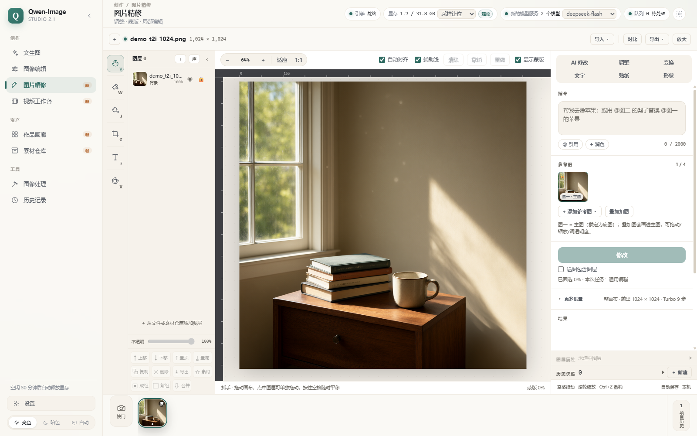
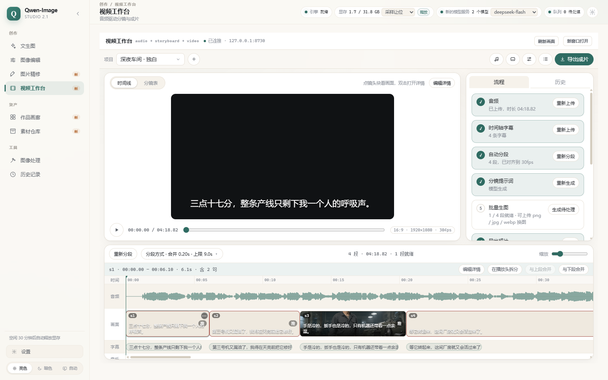
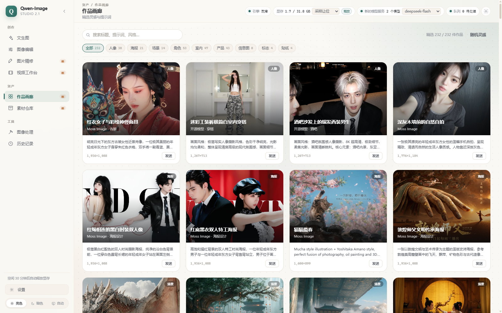
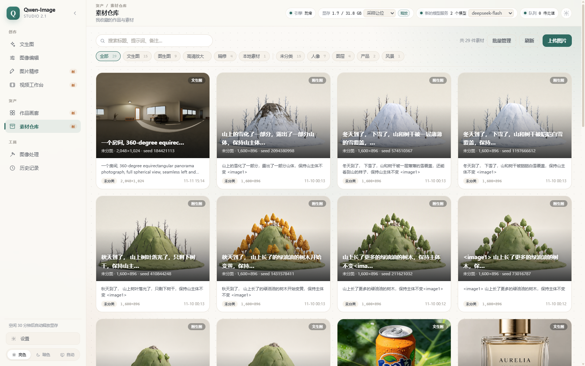
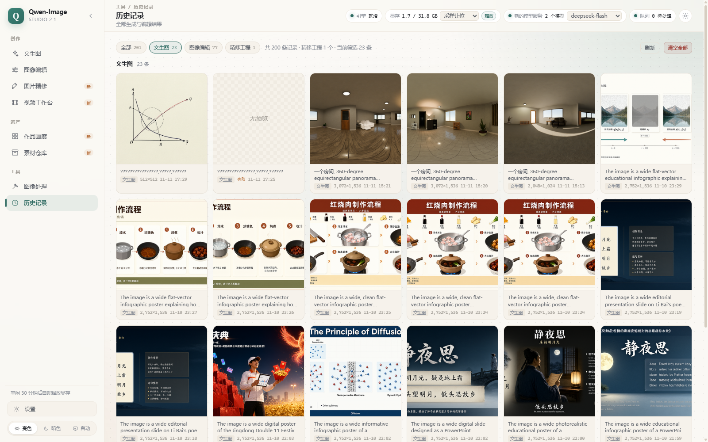

# Qwen-Image 2.1 本地工作台

把 **Qwen-Image 2.1**（统一文生图 + 图像编辑）做成本机可用的完整工作台：
一个独立服务、一个网页界面，**不需要启动 ComfyUI**，可直接复用你 ComfyUI 目录里的权重与 LoRA。

```powershell
powershell -NoProfile -ExecutionPolicy Bypass -File scripts\port_engine.ps1   # 一次性：把引擎移植进项目
powershell -NoProfile -ExecutionPolicy Bypass -File scripts\run.ps1           # 启动
# 浏览器打开 http://127.0.0.1:8700
```

---

## 界面预览

浅色 / 暗色双主题，侧边栏按「创作 / 资产 / 工具」分 8 个页面；
另有独立的工程服务：视频工作台（`video_studio`，8730）、定格工坊（`still_loop`，8720）。

**文生图**


风格 / MJ 码图 / 滤镜 / 视角都是提示词框上方的弹窗，选中后变成可移除标签，正文保持原文：


| 风格 / 滤镜 | MJ 码图馆 |
|---|---|
|  |  |

**图像编辑**：左侧参考图，右侧 Canvas 遮罩编辑，底部指令与风格工具条。


**图片精修**：图层、裁剪、画笔、调色、蒙版，右侧 AI 改图，可导出或送入图像编辑。



**视频工作台**：音频 + 时间轴字幕 → 自动分段 → 分镜提示词 → 批量生图 → 导出成片。



**图像处理**：调整 / 尺寸 / 水印 / 动图 / 放大 / 导出 / 扩图 / 收藏。


扩图规划：算出新画布与原图偏移，把新增区域做成遮罩，一键带去局部重绘。


**资产与记录**

| 作品画廊 | 素材仓库 |
|---|---|
|  |  |



**出图示例**

| 文生图 1024² Turbo 8 步 | 双参考图编辑 | 遮罩局部编辑（遮罩外 0 差异） |
|---|---|---|
|  |  |  |

---

## 功能一览

| 页面 | 能力 |
|---|---|
| 文生图 | Qwen-Image 2.1 / MOSS-Image 切换；官方比例 + 自定义尺寸（32 对齐）；透明背景；边界框布局（MOSS）；Turbo 8 步；多 LoRA 独立强度 |
| 图像编辑 | 1~10 张参考图（第 1 张为编辑目标）；Canvas 蒙版；零像素偏移 + 零色差合成；主体分割、扩图、全景；接力编辑 |
| 图片精修 | 图层 / 裁剪 / 画笔 / 橡皮 / 形状 / 文字 / 贴纸；曝光、色彩、镜像；蒙版；撤销重做；AI 改图 |
| 视频工作台 | 音频 + SRT/VTT/ASS → 自动分段 → 分镜提示词 → 批量生图 → 时间线合成、字幕与 BGM → MP4 |
| 定格工坊 | 照片轨道 / 宫格 / 连续编辑分镜 / 自动化流水线；逐帧生成与定格质感烘焙；顺滑版 + 定格版导出 |
| 作品画廊 | 232 条精选作品与提示词，分类、搜索、随机灵感，一键送文生图或收藏 |
| 素材仓库 | 收藏与上传素材，按来源分类，下载、编辑信息、送入精修 / 文生图 |
| 图像处理 | 裁剪与宫格、旋转翻转、缩放对齐、调色、水印、动图 GIF、高清放大、扩图、格式导出 |
| 历史记录 | 生成 / 编辑 / 放大 / 动图 / 精修工程统一列表，筛选、收藏、送入编辑或精修 |

**零像素偏移 / 零色差**：参考图与采样画布尺寸对齐后再编码，输出尺寸与输入一致；
局部编辑遮罩外逐像素保留原图（`quality.outside_max_abs = 0`），只有过渡带做校色。

**提示词润色**：使用 Qwen 官方 PE 系统提示词，兼容 OpenAI 兼容接口与本地 Ollama；不可用时自动降级为原提示词。

---

## 快速开始

| 项 | 要求 |
|---|---|
| Python | 3.10+，装有 fastapi、uvicorn、Pillow、numpy、torch、transformers、safetensors、scipy、einops |
| GPU | 显存 ≥ 20GB（int8 组合约 16GB） |
| 权重 | Qwen-Image 2.1 的 DiT / 文本编码器 / VAE，可放在任意目录 |

1. 移植引擎：`scripts\port_engine.ps1`（一次性，复制 `engine/`）
2. 配置权重：复制 `config.example.json` 为 `config.json`，改 `model_root` 与模型相对路径
3. 启动：双击 `启动工作台.bat`，或 `scripts\run.ps1`
4. 可选验收：`scripts\verify_engine_port.py`、`scripts\smoke_api.py`、`python -m pytest tests -q`

独立服务：`python -m video_studio.serve`（8730）、`python -m still_loop`（8720）。

---

## 目录结构

```
engine\        移植进来的 ComfyUI 模型实现（GPL-3.0，见 engine/NOTICE.md）
server\        推理编排、模型档案、任务队列、图像处理、分割、放大
web\           原生 ES module 前端（无构建步骤）
video_studio\  视频工作台（独立服务）
still_loop\    定格工坊（独立服务）
animation_kit\ 动画稳定化（GIF 去抖动 / 去闪烁）
panorama_360\  360° 全景查看器
data\          官方 PE 系统提示词
docs\          架构、算法、API 与各模块文档
scripts\       引擎移植 / 启动 / 校验 / 冒烟脚本
tests\         单元测试
```

---

## 文档

| 文档 | 内容 |
|---|---|
| [docs/ARCHITECTURE.md](docs/ARCHITECTURE.md) | 架构与请求生命周期 |
| [docs/BUILD_CONTRACT.md](docs/BUILD_CONTRACT.md) | 模块与 API 契约 |
| [docs/ALIGN_COLOR.md](docs/ALIGN_COLOR.md) | 零偏移与零色差原理 |
| [docs/INFERENCE.md](docs/INFERENCE.md) | 推理实现与显存策略 |
| [docs/IMAGE_TOOLS.md](docs/IMAGE_TOOLS.md) | 图像处理台 |
| [docs/VIDEO_STUDIO.md](docs/VIDEO_STUDIO.md) | 视频工作台 |
| [docs/FLOW_STILL_LOOP.md](docs/FLOW_STILL_LOOP.md) | 定格工坊流程 |
| [docs/WEB_UI.md](docs/WEB_UI.md) | 前端页面与组件 |
| [docs/screenshots/](docs/screenshots/) | 界面截图与出图示例 |

---

## 常见问题

- **必须装 ComfyUI 吗？** 不需要。引擎代码在 `engine/`；只有权重默认指向 ComfyUI 的 `models/`，改 `model_root` 即可。
- **能换 bf16 权重吗？** 可以，把 `unet` / `clip` 换成 bf16 版本，画质略好、显存约翻倍。
- **出图慢？** 先看启动日志的 `[env] torch ... (CUDA 13.x)`；cu128 会慢约 3 倍。冷启动需要权重上卡，模型空闲会自动卸载。
- **Turbo 出图糊？** 需要用官方 8 步 sigma，本项目默认已注入，改过调度请恢复默认。
- **局部编辑整体偏色？** 确认 `local.color_match` 开启、`color_strength` 0.4~0.7，并检查 `quality.outside_max_abs` 为 0。

---

## 许可与致谢

本项目的服务端、前端、算法移植与文档为原创实现，以 [Apache License 2.0](LICENSE) 发布。
`engine/` 是 ComfyUI 的衍生副本（GPL-3.0），**整个仓库对外分发时需遵守 GPL-3.0**；
模型权重、第三方素材与画廊作品版权归各自所有者，不在本项目许可范围内。

完整授权范围、第三方组件清单与使用条款见 [NOTICE.md](NOTICE.md)。
致谢 ComfyUI、Qwen-Image、MOSS-Image、ComfyUI-Precise-Align、ComfyUI-BlueBox、
ComfyUI_VNCCS_Utils、ComfyUI-VOSR2、SeedVR2、FlashVSR、three.js、image-style-kit、
image-tools-kit，以及 AIFISHER 灵感画廊与 OpenZhenZhen 的创作者。
