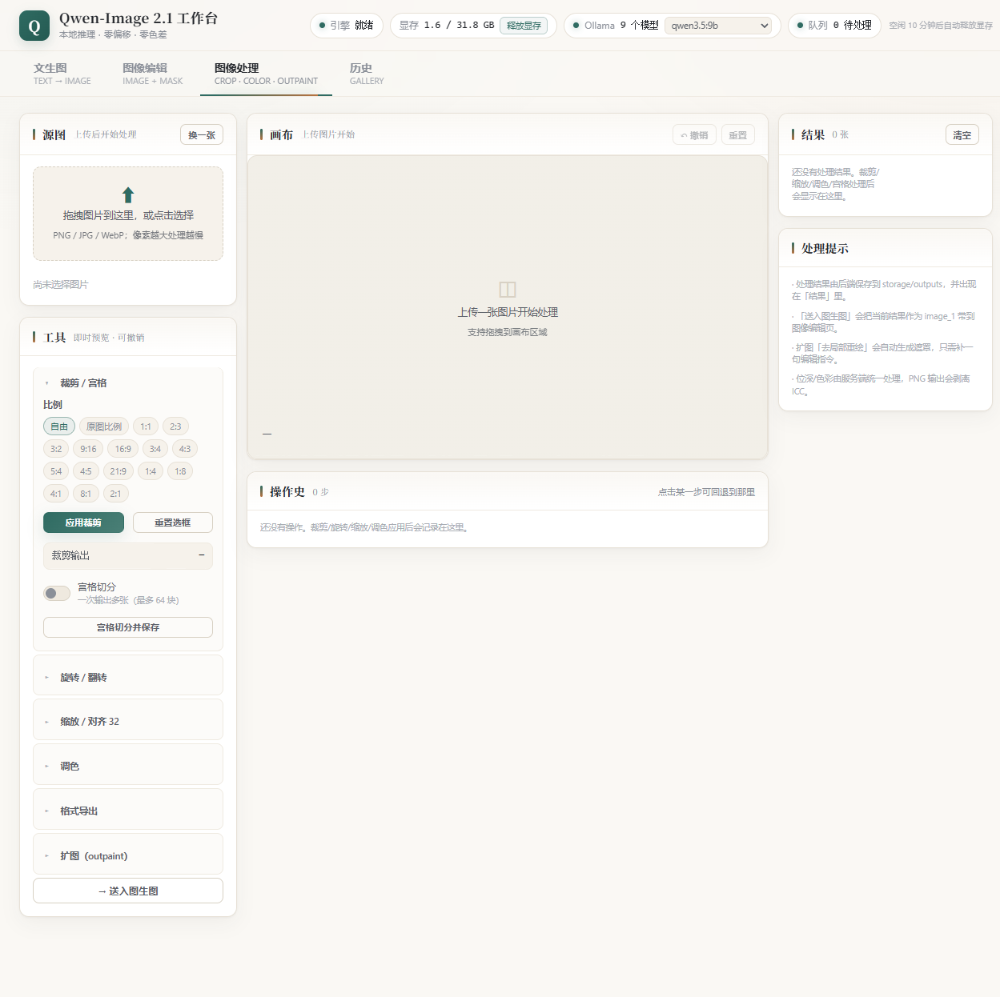
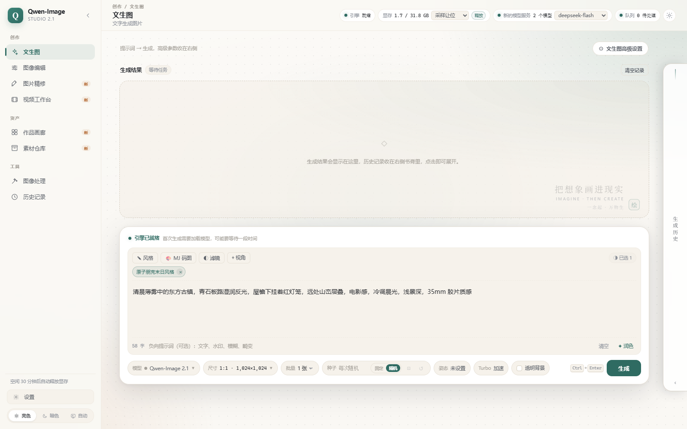
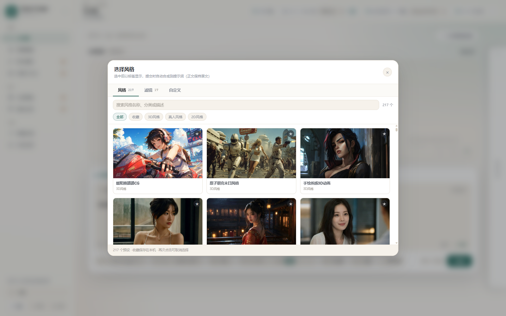
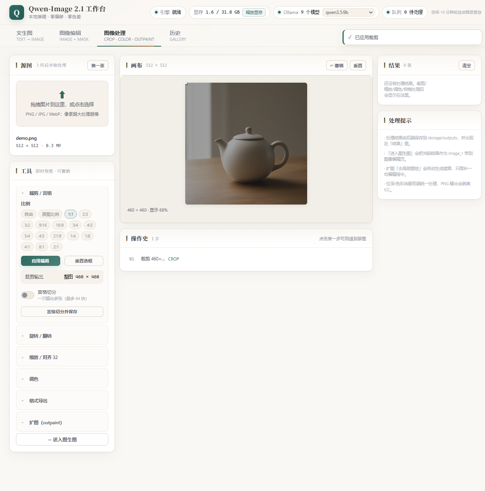
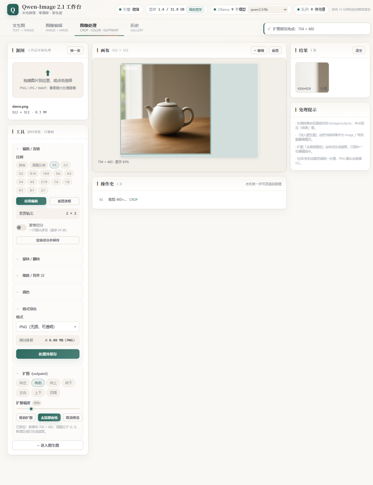
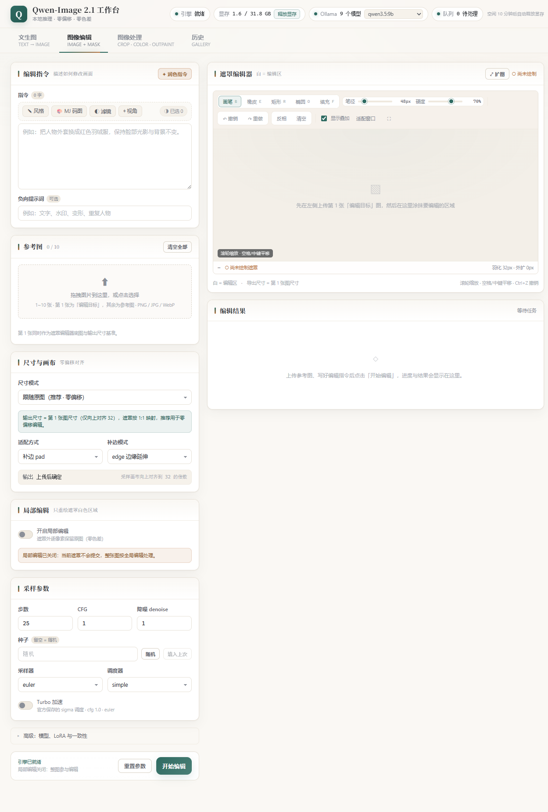
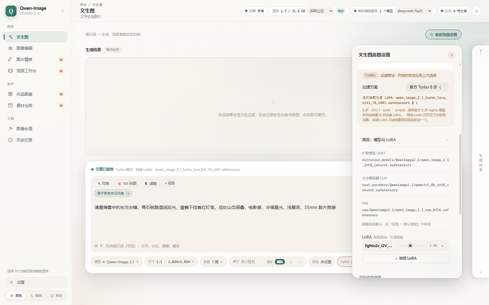

# Qwen-Image 2.1 本地工作台

把 **Qwen-Image 2.1**（统一文生图 + 图像编辑模型）做成本机可用的完整工作台：
一个独立服务、一个网页界面，**不需要启动 ComfyUI**，但可以直接复用你 ComfyUI 目录里的权重和 LoRA。

```powershell
powershell -NoProfile -ExecutionPolicy Bypass -File scripts\port_engine.ps1   # 一次性：把引擎移植进项目
powershell -NoProfile -ExecutionPolicy Bypass -File scripts\run.ps1           # 启动
# 浏览器打开 http://127.0.0.1:8700
```

---

## 一、它做了什么

### 界面预览

浅色 / 暗色双主题，App Shell 侧边栏导航，共 7 个模块：**文生图 / 图像编辑 / 图片精修 / 作品画廊 / 素材仓库 / 图像处理 / 历史记录**。

**文生图**（Turbo 面板直接展示官方 8 个 sigma，可编辑）：



**风格 / 滤镜 / MJ 码图 / 视角 = 提示词框上方的按钮弹窗**，选中即变成可移除标签，
正文始终保持你的原文：



| 风格 / 滤镜弹窗（285 条，真缩略图 + 收藏） | MJ 码图馆（493 条，黄黑主题） |
|---|---|
|  |  |

**图像处理**（裁剪/宫格、旋转翻转、缩放对齐 32、调色、格式导出、扩图规划）：



扩图规划：算出新画布与原图偏移，并把新增区域自动做成遮罩，一键带去局部重绘：



**图像编辑**（左侧参数 + 右侧 Canvas 遮罩编辑器）：



**出图示例**

| 文生图 1024² Turbo 8 步 | 双参考图编辑（条纹布融入房间） | 遮罩局部编辑（茶壶→苹果，遮罩外 0 差异） |
|---|---|---|
|  |  |  |


### Qwen-Image 2.1 官方能力

| 能力 | 说明 | 本工作台 |
|---|---|---|
| 文生图 | 原生 2K（2048×2048），7 种官方比例 | ✅ 比例表 + 自定义尺寸（自动 32 对齐） |
| 图像编辑 | 单图指令编辑，最多 10 张参考图 | ✅ 1~10 张，第 1 张为编辑目标，其余用 `<imageN>` 指代 |
| 原生透明图 | 输出 RGBA | ✅ 透明背景开关（自动套官方 RGBA 提示词模板） |
| Turbo 8 步 | 官方保存的采样 schedule | ✅ 显式注入官方 sigma（见下） |
| 前缀 KV 缓存 | 编辑任务的条件编码复用 | ✅ 引擎层复用（`comfy` 模型实现自带） |

### 多模型：Qwen-Image 2.1 / MOSS-Image

同一套推理引擎，通过**模型档案**（`server/models.py`）区分模型差异，请求里用 `model` 字段切换：

```jsonc
// POST /api/generate
{ "model": "moss", "prompt": "...", "ratio": "3:4", "megapixels": 2.0 }
```

| 项 | `qwen`（默认） | `moss` |
|---|---|---|
| 文生图 | ✅ | ✅ |
| 图像编辑（参考图） | ✅ 1~10 张 | ❌ 本轮未接入 |
| 原生透明图 | ✅ | ❌ |
| 边界框布局 | ❌ | ✅ 可选 |
| SLG | ❌ | ✅ 可选（默认关） |
| 默认采样 | 25 步 / cfg 1.0 / euler | 50 步 / cfg 3.5 / er_sde / simple |
| 加速 | 官方 8 步 sigma 表 | 8 步 LoRA（8 步 / cfg 1.0 / euler） |
| 像素对齐 | 32 | 16 |

`GET /api/options` 新增 `model_profiles`（每个模型的默认值、加速档、能力、缺失文件）与
`default_model`，前端据此渲染模型切换与参数面板。

**边界框请求格式**（`bbox` 可选，仅 MOSS）：

```jsonc
{
  "model": "moss",
  "prompt": "夏日海报",
  "bbox": {
    "enabled": true,
    "character_boxes": "1",
    "items": [
      { "x": 120, "y": 900, "w": 784, "h": 500,
        "type": "character", "desc": "穿校服的少女在草地上跳跃" },
      { "x": 320, "y": 80, "w": 384, "h": 160,
        "type": "text", "text": "清凉一夏",
        "desc": "顶部手写体大标题，深绿色" }
    ]
  }
}
```

- 框用**像素坐标** `x/y/w/h`（画布左上角原点），也可直接给 0..1000 的 element；
- `type` / `text` / `desc` / `palette` 既可写在框顶层，也可包在 `metadata` 里；
- 服务端把框换算成 MOSS 的 `abs_centralized + yxyx` 紧凑 JSON 当提示词；
  不给框时就是普通 caption 文生图。

### 本项目的三项增强

**1. 零像素偏移（Precise-Align 方案移植）**

Qwen-Image 2.1 的文本编码器会把参考图按面积缩放并 32 对齐；只要「参考图尺寸 ≠ 采样画布尺寸」，
参考内容就会被塞到错误的位置——表现为编辑跑偏。本项目的做法：

```
画布向上对齐 32 → 编码器 resolution=0（不再缩放）→ 参考图 / 采样 latent / 画布三者同尺寸
→ 采样 → 裁回源尺寸
```

结果：`size_mode=follow` 时输出尺寸与输入**完全一致**，位置不偏。

**2. 零色差（BlueBox 方案移植）**

```
输入解码：exif 纠正 → ICC→sRGB → 统一 RGBA（不做隐式色彩变换）
合成：遮罩外逐像素保留原图；只有过渡带做 Reinhard 仿射校色
输出：PNG / sRGB / 8bit / 剥离 ICC
```

结果：局部编辑结果的**遮罩外 max_abs_diff = 0**（服务端会把这个数值返回给界面做校验标记）。

**3. 提示词润色（本地 Ollama）**

用 Qwen 官方的 **PE-T2I / PE-I2I 系统提示词**（`data/pe_system_prompt_*.txt`，逐字来自官方
prompt enhancer 发布），让本地 Ollama 模型把一句话扩写成官方风格的长提示词，并顺带给出画幅比例：

- 文生图：输出约 20 句英文描述 + `wh_ratio`（如 `16:9`）
- 图像编辑：输出中文编辑指令，并按模式收口 `ratio_follow`（如 `<image1>`）
- Ollama 不在线时自动降级为原提示词（`fallback=true`），不影响出图

### 风格库（image-style-kit）

复用 `image-style-kit` 的数据与纯逻辑模块（`web/vendor/image-style-kit`），并把它做成了
**提示词框上方的按钮 + 弹窗**（不单独占一页）：

- **工具条**：`✎ 风格` / `🎨 MJ 码图` / `◐ 滤镜` / `⌖ 视角`，右侧显示已选数量
- **选中即标签**：在提示词框上方变成可移除的 chip；**正文框始终保持你的原文**，
  提交时才按「前缀 → 正文 → 后缀 → MJ 参数 → 视角」合成
- **风格 / 滤镜**：285 条预设（217 风格 / 17 滤镜 / 51 运镜数据），搜索 + 分类 + 3 列真缩略图 + 星标收藏
- **MJ 码图馆**：493 条，6 大分组 / 34 分类，四种插入模式（风格码 / 参数 / 完整 / 氛围），
  点卡片直接插到正文光标处
- **视角控件**：azimuth / elevation / zoom → 中文相机语义提示词
- 预览图（约 107MB）来自原项目 `public/`，放在 `web/creative-presets` 与 `web/mj-styles`，
  缺失时自动降级为首字占位

### 图像处理台（image-tools-kit）

出图**前后**的常规处理都在这页完成，路径：`图像处理` 页签。

- **裁剪**：8 个手柄拖拽 + 比例约束（15 种）+ 自由/原图比例；**宫格切分**一次导出多张（带间隔设置）
- **旋转 / 翻转**：90° 步进、任意角度（自动扩画布保四角）、水平/垂直翻转
- **缩放**：contain / cover / stretch，以及一键 **对齐 32**（送进编辑管线前的必备步骤）
- **调色**：亮度 / 对比 / 饱和 / 锐化 / 色温 —— 滑杆实时用 CSS filter 预览，落盘由服务端按真实参数处理
- **格式导出**：PNG（无损、保留透明）/ JPEG（质量可调 + 预估体积）
- **扩图（outpaint）**：左/右/上/下/左右/上下/四周 7 个方向 + 幅度滑杆 → 服务端算新画布与偏移，
  自动把「新增区域」做成遮罩 → 一键「去局部重绘」，跳到编辑页时画布、遮罩、提示词都已就位
- **送入图生图**：当前处理结果直接作为 `image_1` 带去编辑页（带遮罩则一起带过去）

分工是刻意的：**预览在前端 canvas（快），落盘走服务端 Pillow（无损、可控、能进历史）**。
详见 [docs/IMAGE_TOOLS.md](docs/IMAGE_TOOLS.md)。

### 作品画廊 / 素材仓库 / 图片精修

- **作品画廊**（`#gallery`）：24 条精选作品与社区写法提示词（含种子、尺寸、采样参数），
  分类 + 搜索，渐变编号封面；详情可复制提示词、发送到文生图、收藏到素材仓库。
- **素材仓库**（`#materials`）：只收录主动收藏的满意作品与本地上传，区别于全量历史；
  文生图 / 图生图 / 精修 / 本地素材分类展示，支持搜索、编辑信息、下载、删除、
  「在图片精修中打开」与「发送到文生图」。数据存 `storage/materials.json` + 图片目录。
- **图片精修**（`#studio`）：PS 式三栏工作台 —— 抓手 / 裁剪 / 画笔 / 橡皮 / 矩形 / 椭圆，
  曝光、亮度、对比度、饱和度、色温、色调，旋转翻转，蒙版叠加与覆盖率，30 步撤销重做；
  可导出 PNG / JPEG、复制、收藏，或把「当前图 + 蒙版」送入图像编辑做局部重绘。
  快捷键：`V/C/B/E/R/O`、`[` `]`、`0` 适配、`1` 100%、`Ctrl+Z` / `Ctrl+Shift+Z`。

### 操作条与快捷键

- **主操作粘底**：「开始生成 / 开始编辑」固定在视口底部，长表单不用滚到底找按钮
- **进度就在手边**：操作条顶部有 3px 进度细条 + `进行中 3/11 · 扩散采样 · 5.9s` 文案，
  运行中变墨绿、失败变赭红、完成显示 `已完成 · 14.5s`
- **Ctrl / Cmd + Enter** 直接提交
- 失败原因会写进操作条（不用去控制台看）

### 显存管理

- 顶栏实时显示 `显存 x / y GB`，旁边有「释放显存」按钮（`POST /api/engine/free {unload:true}`）
- 服务端有看护线程：队列空闲超过 `config.idle_unload_minutes`（默认 10 分钟）自动卸载模型，
  下次出图按需重载；界面上会提示这一点
- 出图任务固定单 worker 串行，避免两个任务抢同一张卡；每单结束只清缓存不卸载权重（连续出图更快）

---

## 二、Turbo 的 sigma 到底怎么设

这是 **Qwen-Image-2.1-Turbo 最容易踩的坑**。官方权重仓的 `model_index.json` 里存了一份
`sample_sigmas`，8 步采样必须用这一串，用默认的等距调度器会糊：

```
1.0, 0.978453, 0.95418, 0.926626, 0.89508, 0.845148, 0.704534, 0.414568
```

采样时再追加 `0.0`（共 9 个 sigma = 8 步），配 `cfg=1.0`、`sampler=euler`。

本项目把它做成一等公民：`server/config.py` 里的 `TURBO_PROFILES` 预置了档位，
请求里 `turbo.sigmas` 也可以直接传自定义序列。引擎侧用
`torch.FloatTensor(sigmas)` 直接喂给采样器，不经过任何节点图。

### 加速 LoRA 可以自己选

Turbo 面板里有三样东西：**调度方案 / 加速 LoRA / LoRA 强度**。



服务端会扫描 `models/loras` 下「Qwen 系 + turbo/step/lightning」的 LoRA 作为候选，
按「兼容性 → 体积」排好序，并标注体积与是否默认。本机实测候选：

| LoRA | 体积 | 说明 |
|---|---|---|
| `p_q_image_2.1_8_steps_v0.1_comfyui_bf16` | 0.31GB | 小、加载快，8 步 |
| `p_qwen_image_2.1_8step_v0.1` | 0.31GB | 同上（实测 512² 一次成功，画质扎实） |
| `Qwen-Image-2.1-LR-8step-lora-r128` | 0.34GB | 低秩 8 步 |
| `Qwen-Image-2.1-viggle-turbo-v0.3-6step-lora-r128` | 0.63GB | **6 步**，需配 `turbo6_viggle` 档位 |
| `qwen_image_2.1_turbo_lora_avg_rank_178_bf16` | 0.85GB | 平均秩版本 |
| `qwen_image_2.1_turbo_lora_hifi_T8_v001` | **18.22GB** | 默认；画质最好，但加载慢、内存/显存占用大 |
| `Qwen-Image-Lightning-8steps-V1.0` | 1.58GB | Qwen-Image **1.x** 的，2.1 **不兼容**（下拉里置灰） |

- 下拉第一项是「**不挂加速 LoRA**（基座 + 官方 sigma）」；`turbo.lora = "none"` 等价
- 强度可调 0~1.5（默认 1.0）
- 每次任务都会把实际用的 LoRA 记进 `meta.turbo_lora`，例如
  `p_qwen_image_2.1_8step_v0.1.safetensors @ 1.0（用户指定）`，方便复现
- **显存/内存紧张就换 0.31GB 那个** —— 18GB 适配器在 Windows 上偶发 `OSError 1455`（页面文件不足），
  本项目有降级（失败自动不挂 LoRA 继续），但换小 LoRA 更省心

`config.json` 的 `turbo_lora` 仍是「默认选择」，只影响初次打开时的下拉值，不影响已保存的页面设置。

---

## 三、安装与运行

### 环境要求

| 项 | 要求 |
|---|---|
| Python | 3.10+，且装有 `fastapi`、`uvicorn`、`Pillow`、`numpy`、`torch`、`requests`、`safetensors`、`transformers`、`scipy`、`einops` |
| GPU | 显存 ≥ 20GB（int8 权重组合约 16GB）；bf16 组合约 30GB |
| 权重 | Qwen-Image 2.1 的 diffusion model / text encoder / VAE（Comfy-Org 单文件版即可） |
| Ollama | 可选，仅提示词润色需要 |

本机直接复用 ComfyUI 自带的 python（`scripts/run.ps1` 会自动探测）。

### 步骤

1. **移植引擎**（一次性，约 2 秒，复制 5.4MB 纯 Python 代码）

```powershell
powershell -NoProfile -ExecutionPolicy Bypass -File scripts\port_engine.ps1
powershell -NoProfile -ExecutionPolicy Bypass -File scripts\port_engine.ps1 -Check   # 校验
```

2. **配置权重路径**：编辑 `config.json` 的 `model_root`（默认指向本机 ComfyUI 的 `models/`）。

3. **启动**

```powershell
# 方式一（推荐）：双击项目根目录的「启动工作台.bat」，会自动开浏览器
# 方式二：命令行
powershell -NoProfile -ExecutionPolicy Bypass -File scripts\run.ps1
```

4. **验收**（可选，会真出图）

```powershell
& "<python>" scripts\verify_engine_port.py     # 引擎独立性 + 出图 + 确定性
& "<python>" scripts\smoke_api.py              # 全链路 API 冒烟（16 项）
& "<python>" scripts\smoke_advanced.py         # 进阶：RGBA / 多参考图 / 比例模式（4 项）
& "<python>" scripts\smoke_features.py         # 功能矩阵：batch / cfg / fixed_point / 方案B / denoise / 3 参考图（9 项）
& "<python>" -m pytest tests -q                # 单元测试（204 项）
```

5. **（可选）风格库预览图**：从 image-style-kit 原项目同步约 107MB 缩略图

```powershell
powershell -NoProfile -ExecutionPolicy Bypass -File scripts\sync_style_assets.ps1
```

### 验收结果（本机实测）

| 项 | 结果 |
|---|---|
| 单元测试 | **230 passed**（纯 CPU，约 23s；含图像处理 18 项、任务队列 8 项、Turbo LoRA 7 项） |
| 全链路 API 冒烟 | **16 / 16 PASS** |
| 进阶冒烟（RGBA / 多参考图 / 比例） | **4 / 4 PASS** |
| 功能矩阵冒烟 | **9 / 9 PASS** |
| 引擎独立性校验 | PASS（`comfy.sd` / `node_helpers` 均在 `engine/` 内） |
| 零色差验收 | 局部编辑遮罩外 `max_abs_diff = 0`（方案 A 与方案 B 均通过） |
| 零偏移验收 | `size_mode=follow` 输出尺寸 == 输入尺寸，画布为 32 倍数 |
| 图像处理接口 | crop / grid(6 块) / pad32+adjust / jpeg / outpaint-plan 全部实测通过 |
| 浏览器实测 | 7 个模块 + 风格弹窗 + 遮罩编辑器 + 图片精修 + 素材仓库 + 作品画廊全链路 |

### config.json 字段

| 字段 | 默认 | 说明 |
|---|---|---|
| `engine_dir` | `engine` | 引擎代码目录（项目内，由 port_engine 生成） |
| `model_root` | ComfyUI 的 `models/` | 权重根目录；只读使用 |
| `unet` / `clip` / `vae` | 见文件 | 相对 `model_root` 的路径，也可写绝对路径 |
| `turbo_lora` | `qwen_image_2.1_turbo_lora_hifi_T8_v001` | Turbo 8 步用的适配 LoRA |
| `consistency_lora` | `qwen-image-2.1-consistency-2000` | 局部编辑保持主体一致性 |
| `model` | `qwen` | 默认图像模型（`qwen` / `moss`），请求里的 `model` 优先 |
| `moss` | 见文件 | MOSS 档案：`unet/clip/vae/turbo_lora`、`steps=50/cfg=3.5/er_sde`、`turbo_steps=8/turbo_cfg=1/euler`、`negative_prompt`、`slg` |
| `port` | 8700 | 服务端口 |
| `ollama_url` | `http://127.0.0.1:11434` | 本地 Ollama |
| `max_batch` / `max_side` | 4 / 4096 | 资源上限保护 |
| `turbo_profile` | `turbo8_official` | 默认 Turbo 档位 |
| `tiled_decode_threshold` | 600000 | 输出像素超过它就直接分块解码（避免全量 OOM 重试） |
| `png_compress_level` | 1 | 输出 PNG 压缩档位，只影响速度/体积，不影响画质 |
| `encode_cache_size` | 8 | 文本编码结果缓存条数（同提示词连抽复用），0 = 关闭 |

---

## 四、目录结构

```
<PROJECT_ROOT>\
├─ engine\                 ← 移植进来的 ComfyUI 模型库代码（comfy/ + node_helpers.py）
│   ├─ comfy\              ← 329 个纯 Python 文件：DiT / VAE / 文本编码器 / 采样器 / LoRA
│   ├─ SOURCE.json         ← 来源、版本、commit、文件数
│   └─ NOTICE.md           ← GPL-3.0 说明
├─ server\
│   ├─ main.py             FastAPI 入口与路由
│   ├─ config.py           配置 / 比例表 / Turbo 档位 / 模型扫描
│   ├─ models.py           模型档案注册表（qwen / moss：权重、latent、采样默认、加速、能力）
│   ├─ moss.py             MOSS 专有纯逻辑：分辨率选择 / 边界框换算 / 布局提示词 / SLG 配置
│   ├─ pipeline.py         编排：解码 → 对齐画布 → 采样 → 裁回 → 合成 → 存盘
│   ├─ backends\native.py  进程内推理引擎（两模型共用）
│   ├─ align.py            Precise-Align 几何/颜色算法移植（纯 numpy）
│   ├─ imaging.py          BlueBox 图像 I/O + 画布规划 + 合成移植
│   ├─ ollama.py           Ollama 客户端
│   ├─ prompt_polish.py    官方 PE 提示词润色
│   ├─ styles.py           image-style-kit 目录 + 提示词合成
│   ├─ jobs.py             单 worker 任务队列 + 进度 + 历史
│   └─ storage.py          文件存取
├─ web\                    原生 ES module 前端（无构建步骤）
│   ├─ index.html
│   ├─ src\
│   │   ├─ app.js / api.js / store.js / utils.js
│   │   └─ components\      t2i / edit / maskEditor / stylePicker / jobView / history / polish / modal / toast / controls
│   ├─ assets\css\          app.css / mask.css / tools.css
│   ├─ vendor\image-style-kit\   纯逻辑 ES module（buildNodePrompt 等）
│   ├─ vendor\image-tools-kit\   裁切几何 / canvas 渲染 / 扩图提示词（纯逻辑）
│   ├─ creative-presets\   ← 风格预览图（可选，来自原项目 public/）
│   └─ mj-styles\          ← MJ 码图预览图（可选）
├─ data\                   PE 官方系统提示词
├─ docs\                   架构、算法、API、各模块文档 + 界面截图
├─ scripts\                port_engine / run / verify / smoke / sync_style_assets
├─ tests\                  单元测试（230 项）
├─ 启动工作台.bat           一键启动（双击即可，等价于 scripts\run.ps1）
├─ config.json
└─ pytest.py               离线 pytest 兼容运行器
```

---

## 五、HTTP API 速查

| 方法 | 路径 | 说明 |
|---|---|---|
| GET | `/api/health` | 引擎 / Ollama / 队列 / 显存 / 空闲时长 |
| GET | `/api/options` | 模型清单、**模型档案 `model_profiles` / `default_model`**、采样器、比例、Turbo 档位、默认值 |
| GET | `/api/styles` | 风格库目录（285 + 493 条） |
| GET | `/api/styles/angle-prompt` | 视角提示词 |
| POST | `/api/polish` | 提示词润色（`mode=t2i\|edit`，`image_model=qwen\|moss`，可带 `target_size` / `references` / `images`） |
| POST | `/api/generate` | 提交文生图任务 → `{job_id}`（`model` / `ratio` / `bbox`） |
| POST | `/api/edit` | 提交图像编辑任务 → `{job_id}` |
| POST | `/api/image/process` | 图像处理：crop / grid / rotate / flip / resize / adjust / pad32 / trim_alpha |
| POST | `/api/image/outpaint-plan` | 扩图规划：返回新画布、pad、原图偏移 |
| POST | `/api/engine/free` | 释放显存（`unload=true` 卸载模型） |
| POST | `/api/engine/warmup` | 预加载默认模型 |
| GET | `/api/jobs/{id}` | 任务状态 / 进度 / 结果 / 对齐信息 / 质量指标 |
| POST | `/api/jobs/{id}/cancel` | 取消 |
| GET | `/api/jobs/{id}/replay.json` | 导出可复现参数 |
| GET | `/api/history` | 历史（含缩略图与参数） |
| DELETE | `/api/history[/{id}]` | 清空 / 删除单条历史 |
| POST | `/api/upload` | 上传图片 |
| POST | `/api/engine/warmup` / `free` | 预加载 / 释放显存 |

完整字段见 `docs/BUILD_CONTRACT.md` 第 3 节。

---

## 六、文档索引

| 文档 | 内容 |
|---|---|
| [docs/ARCHITECTURE.md](docs/ARCHITECTURE.md) | 整体架构、为什么能脱离 ComfyUI、请求生命周期 |
| [docs/BUILD_CONTRACT.md](docs/BUILD_CONTRACT.md) | 模块契约 + API 契约 + 验收标准 |
| [docs/ALIGN_COLOR.md](docs/ALIGN_COLOR.md) | 零偏移与零色差原理、参数推荐 |
| [docs/INFERENCE.md](docs/INFERENCE.md) | 推理引擎实现、显存策略、实测数据 |
| [docs/PROMPT_POLISH.md](docs/PROMPT_POLISH.md) | 提示词润色的官方规则与 Ollama 实测 |
| [docs/STYLE_KIT.md](docs/STYLE_KIT.md) | 风格库接入说明 |
| [docs/IMAGE_TOOLS.md](docs/IMAGE_TOOLS.md) | 图像处理台：裁切/宫格/调色/扩图与 image-tools-kit 接入 |
| [docs/WEB_UI.md](docs/WEB_UI.md) | 前端页面与组件结构（App Shell + 7 个模块 + 风格选择器弹窗） |
| [docs/screenshots/](docs/screenshots/) | 界面截图与出图示例 |

---

## 七、性能实测（RTX 5090 32GB，int8 unet + int8 TE + bf16 VAE）

### 先说最关键的：torch 必须是 cu130

`comfy_kitchen` 的 int8 原生算子要求 **torch 的 CUDA ≥ 13**。低于这个版本时，算子会被
禁用、回退到 eager，采样会掉进 `cutlass_80_wmma_tensorop_..._s8` 慢路径 —— 同一张图
**12.4 秒 vs 4.3 秒**。

最容易踩的坑不是没装 cu130，而是**装了两份 torch**：ComfyUI 自带的 python 里有 cu130，
但 `AppData\Roaming\Python\...\site-packages` 里还有一份 cu128，普通启动会优先用前者之外的后者。
所以本项目启动器用 **`python -s`**（禁用 user site-packages）启动，并在启动时打印：

```
[env] torch 2.13.0+cu130 (CUDA 13.0) | file=D:\...\python\Lib\site-packages\torch\...
```

看到 `CUDA < 13` 的黄色警告就说明用错 torch 了（服务仍能跑，只是慢 3 倍）。

### 实测数据（cu130，Turbo 8 步 + HiFi 18GB LoRA）

| 场景 | 尺寸 | 冷启动首张 | **热态每张（端到端）** |
|---|---|---|---|
| 文生图 · Turbo | 512×512 | 约 20s | **0.8s** |
| 文生图 · Turbo | 1024×1024 | 32.8s | **2.1s** |
| 文生图 · Turbo | 2016×1152 | 约 33s | **5.3s** |
| 文生图 · Turbo | 2752×1536 | — | **12.3s** |
| 文生图 · 默认 25 步 | 2048×2048 | — | 约 25s |

> 对照：同一台机器、同一份权重与 LoRA，ComfyUI 的日志是
> `Prompt executed in 4.95 seconds`（2016×1152）。注意口径：2.3MP 的**全量** VAE 解码在本机
> 即使不挂 LoRA 也会 OOM（峰值 >28GB），所以任何实现都逃不掉约 1.1s 的分块解码；
> 本项目 5.25s 已在此基础上，1MP 档更是 2.1s（ComfyUI 同尺寸约 5s）。
> 详细拆解（编码/采样/解码/PNG/free）与调参过程见 [docs/INFERENCE.md](docs/INFERENCE.md) 第 4.0、5.2、6.4 节。

### 七个已修复的性能坑（都实测过，别踩回去）

| 现象 | 根因 | 修法 |
|---|---|---|
| 每张图慢 3 倍 | torch 是 cu128，int8 原生算子被禁用，GEMM 走 sm80 wmma 慢路径 | 用 `-s` 启动拿 cu130（启动器已内置 + 启动自检） |
| 2MP 以上解码 6 秒 | 全量 VAE 解码既 OOM 又慢（latent 2.3MP 的空间注意力超线性） | 大图**直接**分块解码，`vae_tile_size=1024`（比默认 512 快 2.3 倍：1.3s vs 3.0s） |
| 每张图重新挂 18GB LoRA | `apply_loras` 每次从基座重挂 | 加签名缓存，同一组 LoRA 直接返回（0ms） |
| 1MP 出图慢一倍、日志反复 OOM | 阈值按"CLIP 已让位"估的（1.5MP），实际 CLIP 常驻时 1024² 全量解码必 OOM，回退分块要 3.4s | 文本编码器**常驻**显存 + `tiled_decode_threshold=600000`（1024² 从 7.4s → 2.7s） |
| 每张多花 0.3~0.5s | 每单 `soft_empty_cache` + `gc.collect`（0.22s）、PNG lv6（0.31s）、缩略图把刚编码的 PNG 又解码一遍（0.15s） | 只清 `empty_cache`；`png_compress_level` 默认 1；缩略图直接从内存 PIL 图缩放（1024² 再降到 2.1s） |
| 同提示词连抽多张，每张都重算一遍文本编码 | `encode_text` 每单都跑一次 CLIP 前向；编辑链路还要重做参考图 VAE 编码（1.4s） | 加 LRU 缓存（`encode_cache_size`，默认 8）：纯文本省 145ms/张，带参考图的编辑省 1.4s/张 |

显存占用：

| 组合 | 峰值 |
|---|---|
| unet + TE + VAE（不挂 LoRA） | ≈ 14.5 GB |
| 再挂 18.22GB 的 HiFi Turbo 适配器 | ≈ 26 GB |
| 2K 采样 | ≈ 30 GB |

> Turbo 适配器（`qwen_image_2.1_turbo_lora_hifi_T8_v001`，18.22GB）在 Windows 上偶发
> `OSError 1455`（页面文件/提交量不足）导致 mmap 失败。本项目已做**降级处理**：
> LoRA 挂载失败则自动退化为「不挂 LoRA 的 8 步」，任务继续并在 `meta.lora_warning` 里提示，
> 不会整单失败。若你的机器显存/页面文件紧张，建议改用 0.31GB 的小加速 LoRA 或
> `turbo_profiles` 里的 `turbo8_ckpt`（不挂 LoRA，实测质量已足够）。

## 八、常见问题

**Q：能不能不用 ComfyUI 的目录？**
引擎代码已经移植进 `engine/`（不再依赖 ComfyUI 源码）。只有**权重文件**默认指向 ComfyUI 的
`models/`；把 `model_root` 改成任意目录、或把对应字段写成绝对路径即可。

**Q：权重能用 bf16 吗？**
可以。把 `unet` 换成 `diffusion_models/QwenImage2.1/qwen_image_2.1_bf16.safetensors`、
`clip` 换成 `text_encoders/Qweniamge2.1/qwen3vl_8b_bf16.safetensors`，画质略好但显存约翻倍。

**Q：出图很慢？**
先看启动日志里的 `[env] torch ... (CUDA x)`：不是 13.x 就是用了 cu128 的 torch（慢约 3 倍）。
其次看是不是刚冷启动（权重要上卡，20~25s）；模型空闲 30 分钟会被自动卸载，下一次再上卡。
热态参考值：512² ≈ 0.8s、1024² ≈ 2.1s、2016×1152 ≈ 5.3s（端到端，含落盘）。

**Q：Turbo 出图糊？**
必须用官方 sigma（本文第二节）。本项目默认已注入；如果你手改过 `sigmas` 或换了调度器，请恢复。

**Q：局部编辑后整体颜色变了？**
检查 `local.color_match=true`、`color_strength` 0.4~0.7，并确认界面显示的
`quality.outside_max_abs` 为 0。若不为 0，说明合成链路被绕过（例如手动改了画布尺寸）。

**Q：编辑后人物/商品变了？**
零偏移只保证几何对齐，内容一致性要靠 `consistency_lora`（默认已挂
`qwen-image-2.1-consistency-2000`，强度 1.0）。

---

## 九、许可与致谢

本项目的**服务端、前端、算法移植、文档**为原创实现，以 [Apache License 2.0](LICENSE) 发布。

完整的授权范围（哪些目录不在 Apache-2.0 覆盖内）、第三方组件清单与使用条款，见
[NOTICE.md](NOTICE.md)。

第三方代码与素材：

| 来源 | 用途 | 许可 |
|---|---|---|
| [ComfyUI](https://github.com/comfyanonymous/ComfyUI) | `engine/` 内的模型实现（DiT/VAE/文本编码器/采样器/LoRA），**未修改** | GPL-3.0 |
| ComfyUI-Precise-Align（本机安装的节点包） | 零偏移几何算法参考，已重写为纯 numpy | Apache-2.0 |
| [ComfyUI-BlueBox](https://github.com/zhoutingxi/ComfyUI-BlueBox) | 32 不动点 + 图像 I/O 参考，已重写 | MIT |
| [ComfyUI_VNCCS_Utils](https://github.com/AHEKOT/ComfyUI_VNCCS_Utils) | 3D 姿态编辑器内核（vendor） | MIT（MakeHuman 人体数据 CC0） |
| [ComfyUI-VOSR2](https://github.com/ylchen333/ComfyUI-VOSR2) / SeedVR2 / FlashVSR | 高清放大引擎（vendor） | Apache-2.0 / Apache-2.0 / 见上游 |
| [three.js](https://github.com/mrdoob/three.js) | 3D 渲染与 360° 全景查看器 | MIT |
| [image-style-kit / image-tools-kit](..)（本机 `AIFISHER` 项目） | 风格库、MJ 码图、裁切/宫格/扩图逻辑，整体 vendor 进 `web/vendor/` | 见其 README |
| [Qwen-Image-2.1](https://github.com/QwenLM/Qwen-Image-2.1) | 模型权重与官方 PE 系统提示词 | Qwen Research License |
| [AIFISHER 灵感画廊](https://gallery.work-fisher.com/) / [OpenZhenZhen](https://www.openzhenzhen.com/) | 作品画廊封面与提示词（版权归原作者） | 仅作示例，不随本许可授权 |

> `engine/` 是 ComfyUI 的衍生副本，受 GPL-3.0 约束：本地自用无碍；**对外分发本项目时需遵守 GPL-3.0**。
> 模型权重、第三方素材不在本仓库内，也不在本项目许可范围内，商用前请自行核对各自许可证。

### 使用条款摘要

1. 遵守所在地区法律法规，不得用于违法或侵害他人权益的用途。
2. 生成内容与输入素材的责任由使用者承担；涉及肖像、作品的场景须确保已获授权，禁止深度伪造。
3. 本项目按「现状」提供，不附带任何担保，作者不对使用后果负责。
4. Qwen、ComfyUI、MOSS、SeedVR2、FlashVSR、VOSR2 等商标归各自所有者，本项目与其无隶属关系。

完整条款见 [NOTICE.md](NOTICE.md) 第二部分。
